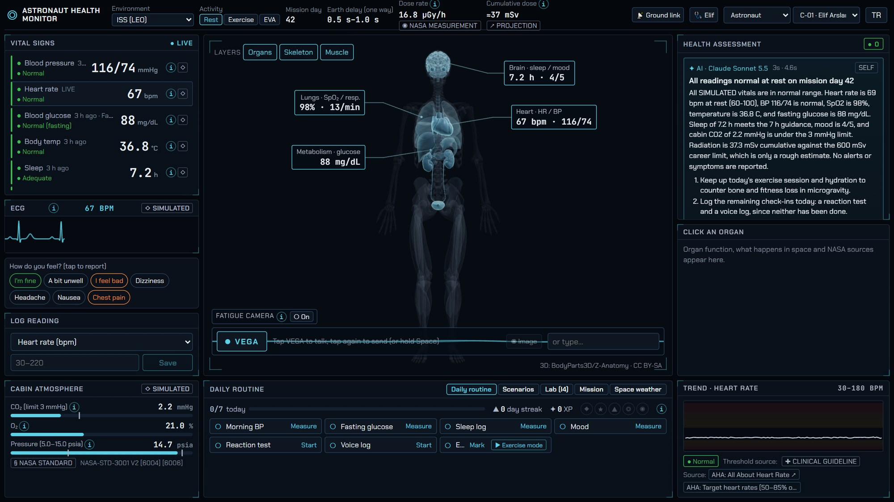

# NASAlytics: Astronaut Health Monitor

Our entry for the NASA Space Apps Challenge 2026 (Sivas), challenge *Create Health Monitoring Software for Astronauts on Space Missions*.

**Live demo:** https://asicservices.com/nasalytics/ (works on phones too)
**Slides:** [English](sunum/NASAlytics_Presentation_EN.pdf) · [Türkçe](sunum/NASAlytics_Sunum_TR.pdf)



## The idea

On the ISS a sick astronaut talks to a flight surgeon almost in real time. On the way to Mars a message takes 3 to 22 minutes one way, and the link can drop altogether. The crew has to judge their own health and act on it.

NASAlytics is a single screen for that: a clickable 3D body, ten health indicators with color, icon and text status, step-by-step guidance when something is off, and a voice assistant (VEGA) you can simply talk to. The interface is in Turkish and English.

One rule shaped the whole design: **rules decide, AI explains.**

- Alarms come from a deterministic rule engine. Thresholds are taken from NASA-STD-3001 and clinical guidelines. It runs in the browser and keeps working with no internet.
- Intervention cards are copied from NASA medical checklists, with the drug name, dose and page number as printed.
- The language model only summarizes and ranks. It can point to a drug by its library ID, but it cannot write a dose: any dose-like number in its output is stripped on the server.

Every number on screen carries a tag saying where it came from (NASA measurement, NASA standard, clinical guideline, projection, assumption, simulated). Vital signs are simulated and are labelled that way.

## What is in it

- **Astronaut view.** 3D body with organ, skeleton and muscle layers, vitals, ECG strip, cabin atmosphere, trends, daily routine with streaks and badges, tap-to-report symptom chips, an on-device fatigue camera.
- **Crew medical officer view.** Every crew member live, side by side, with intervention cards for whoever needs attention.
- **Ground view.** The same data, shown late by the real one-way communication delay of the selected environment.
- **Loss of signal.** Cut the ground link and the crew views stay live, data is held on board and delivered in order when the link returns, and the cloud AI goes quiet while rules and cards keep working.
- **Crew medical record.** Age, height, mass, BMI, blood type, allergies. A recorded allergy that matches a suggested drug is struck through with a "do not give" warning.
- **Exercise.** Only movements named in NASA's exercise and bone-loss briefs, plus a personal target heart-rate band from age. No loads, sets or reps, because NASA leaves those to each astronaut's own specialist.
- **Ten scenarios**, including replays of the September 2017 solar storm on the ISS and the May 2024 storm at Mars, both from measured data.
- **Six environments:** ISS, lunar transit, lunar base, Mars transit, Mars base, interplanetary space.

The three crew members in the demo are fictional.

## Data

| Source | Used for |
|---|---|
| ISS TEPC dose analyzer, data.nasa.gov | ISS baseline dose rate, September 2017 storm replay |
| NASA OSDR RadLab | Artemis I, Mars transit and Mars surface dose; May 2024 storm |
| NASA OSDR OSD-569 and OSD-575 (Inspiration4) | Blood count and metabolic panels in the Lab tab |
| NASA DONKI | Live space weather events, last 7 days |
| NASA-STD-3001 and OCHMO technical briefs | Thresholds for CO₂, pressure, oxygen, radiation, decompression, bone loss |
| ISS emergency medical procedures, JSC-48031 medical checklist | Intervention cards, medication kit, loss-of-signal rule |
| OCHMO-TB-031, OCHMO-MTB-013 | Exercise countermeasures |
| NASA HRP hazards and risks pages, CSA resources | Organ explanations |

Non-NASA sources are the AHA, ADA and CDC guidelines for clinical thresholds, the BodyParts3D / Z-Anatomy model (CC BY-SA) and the forge-motion exercise loops (CC0).

The complete list, with links and what each one was used for, is in [SOURCES.md](SOURCES.md). `python tools/check_sources.py` fails if the code links to anything that is not logged there.

## Running it locally

You need Node 20+ and Python 3.11+.

```bash
git clone https://github.com/chuckywins/nasalytics.git
cd nasalytics

# backend
python -m venv .venv
source .venv/bin/activate          # Windows: .venv\Scripts\activate
pip install -r backend/requirements.txt
cp .env.example .env               # then put your keys in .env
python -m uvicorn backend.server:app --host 127.0.0.1 --port 8790
```

In a second terminal:

```bash
cd frontend
npm install
npm run dev
```

Open the address Vite prints (usually http://localhost:5173). The dev server forwards `/api` and `/ws` to the backend on port 8790.

To try the three views, open the app in two or three tabs or devices and pick a role (Astronaut, Crew, Ground) in the top-right corner.

### Keys

| Variable | Needed for | Without it |
|---|---|---|
| `ANTHROPIC_API_KEY` | AI assessment, intervention ranking, VEGA | Rules, alarms, cards, 3D body and scenarios still work |
| `GEMINI_API_KEYS` | VEGA's voice and spoken alarms (comma-separated list is fine) | No speech output |
| `NASA_API_KEY` | Live DONKI space weather | Falls back to NASA's shared `DEMO_KEY` |
| `AZURE_SPEECH_KEY`, `AZURE_SPEECH_REGION` | Backup voice | Optional |

Keys stay on the server and never reach the browser. The backend has a per-IP rate limit and a daily spending cap (`RATE_PER_MIN`, `DAILY_BUDGET_USD`).

### Production build

```bash
cd frontend && npm run build
```

The backend serves `frontend/dist` itself, so one process is enough. To host under a sub-path, build with `NASA_BASE=/your-path/ npm run build` and start the backend with `URL_PREFIX=/your-path`. [DEPLOY.md](DEPLOY.md) has the full steps we used on our own server (in Turkish).

### Rebuilding the data files

The processed NASA series live in `frontend/src/data/`. To regenerate them from the raw files in `data/raw/`:

```bash
python -I tools/build_data.py
```

One raw file, the hourly RadLab export, is too large for the repository; SOURCES.md says where it comes from.

## Layout

```
backend/server.py      FastAPI: AI proxy, telemetry relay (WebSocket), text-to-speech, DONKI
frontend/src/engine/   rule engine, thresholds, intervention library, exercise data
frontend/src/          React app, 3D body, views
data/raw/              raw NASA data
tools/                 data build and source audit scripts
docs/                  challenge text, research notes, reference documents
```

## Tech

React 19, TypeScript, three.js (react-three-fiber), zustand, Vite. FastAPI and WebSockets on the server. MediaPipe for the on-device fatigue camera. Claude Sonnet 5.5 and Haiku 5.5 for text, Gemini for speech.

## Use of AI

In the app, language models summarize the crew member's state, rank the intervention cards and power the VEGA assistant; VEGA's voice and the spoken alarms are synthetic speech. Alarms, thresholds, NASA data and medication doses do not come from a model.

We also used AI coding assistants while building this. Source files written that way say so in their header comment. No NASA logos or mission insignia are used or generated anywhere in the project.

## Limits

This is a hackathon prototype, not a medical device, and it does not diagnose. Vital signs are simulated; connecting real wearable sensors is the next step. The cloud models would have to run on board for a real deep-space mission.
